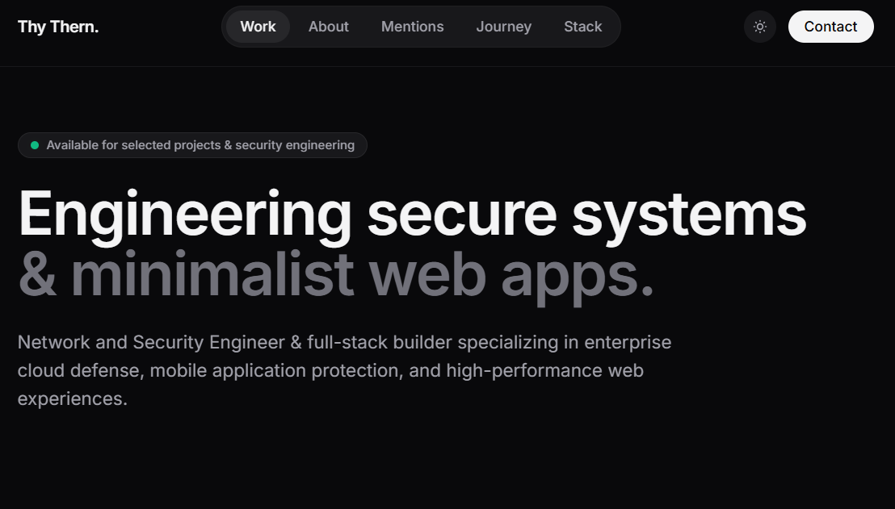
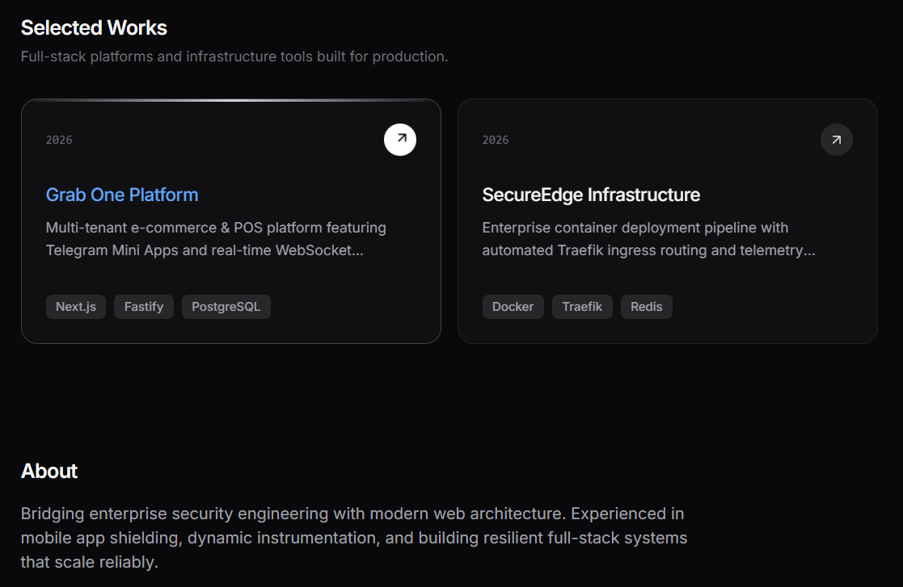
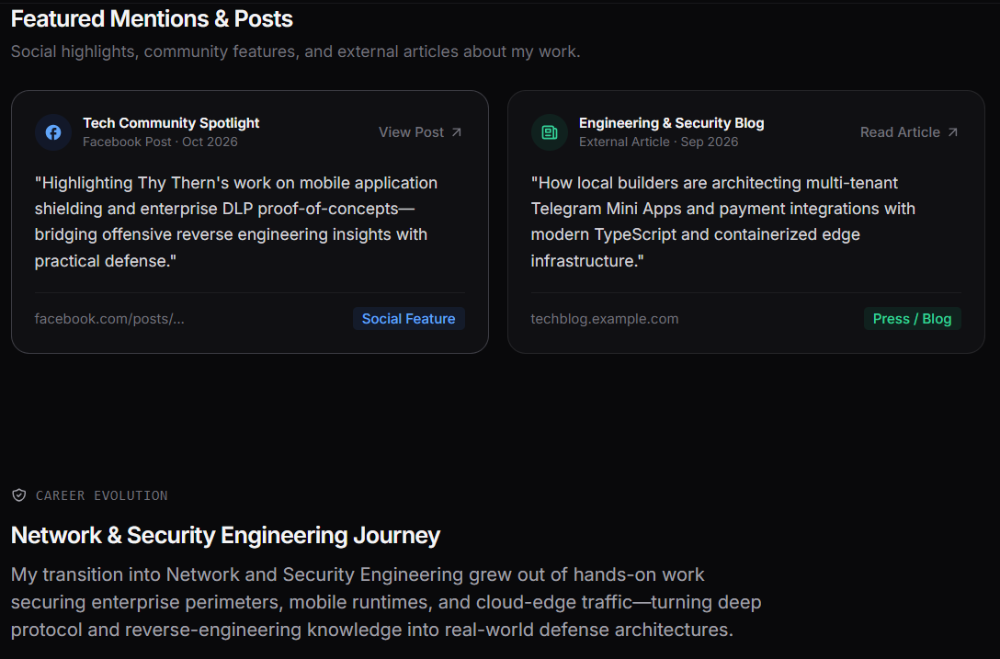
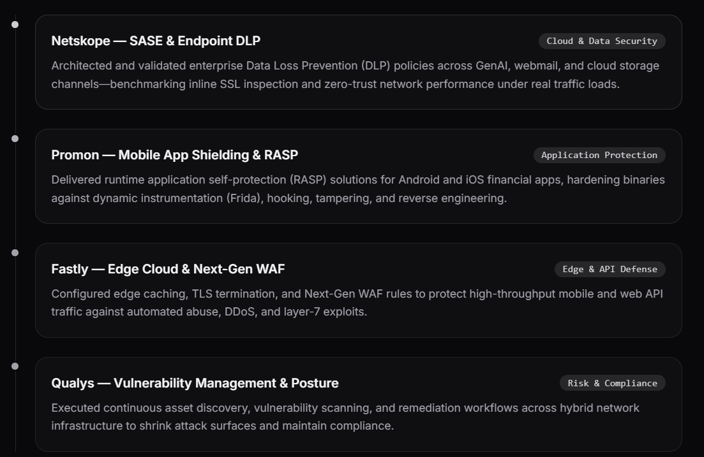

# Thy Thern — Portfolio (v2026)

Minimalist dark portfolio for a Network & Security Engineer and full-stack builder.
Built with React, TypeScript, Vite, Tailwind CSS v4, Framer Motion and Lucide icons.

## Screenshots

### Hero


### Selected Works & About


### Featured Mentions & Career Journey


### Journey Timeline


## Development

```bash
npm install
npm run dev      # local dev server
npm run build    # production build -> dist/
```

## Deploy

Build and deploy the site with Docker Compose. The included Dockerfile builds the Vite app and packages the generated `dist/` files into Nginx (behind Traefik, domain `thernthy.site`):

```bash
docker compose up -d --build
```

To deploy a newer version after pulling the latest branch:

```bash
git pull origin v2026
docker compose up -d --build
```
